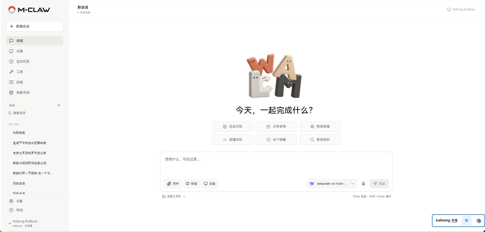

<p align="center">
  <a href="../README.md">English</a> | <strong>简体中文</strong>
</p>

<p align="center">
  
</p>

<h2 align="center">自进化具身智能体运行时<br>Self-Evolving Embodied Agent Harness</h2>

<p align="center">
  <a href="#安装与启动">快速开始</a> ·
  <a href="#更新">版本更新</a> ·
  <a href="#能力概览">功能</a> ·
  <a href="manual/README.md">操作手册</a> ·
  <a href="#智能体循环">架构</a> ·
  <a href="#开发者生态">开发</a>
</p>

<p align="center">
  
  
  
  
</p>

**M-CLAW 是 M-Robots OS 原生的具身智能体运行时，面向异构多机协同场景，打通模型与物理世界的执行桥梁。**

以 Agent Harness 为核心，将上下文与记忆、工具与 Skill 调用、设备操作和协作任务组织为统一的执行闭环。通过 Web 界面或 CLI 发起任务、查看过程与结果；在满足系统条件的 M-Robots OS / Kaihong OS 设备上，依托 M-DDS 支持“一机一脑、多脑协同”。统一空间表示与持续位置记忆属于后续路线图。



<p align="center"><em>M-CLAW Version 1.1.2 Overview</em></p>

> 当前版本：1.1.2<br>
> 开源协议：Apache-2.0<br>
> 当前安装方式：从源码安装<br>
> 📖 [M-CLAW 用户手册](manual/README.md)

## 路线图

以下为上游项目路线图：1.0 和 1.1 为已有版本里程碑；1.2 和 2.0 为规划方向，日期为上游目标，不代表当前版本已实现。

### 2026.06 | **1.0.0 单机智能体运行时**

完成智能体运行时闭环，在 M-Robots OS 上验证“模型驱动执行 + 工具调用 + 记忆 + Skill 扩展 + 机器人控制”的端到端执行链路。

### 2026.09 | **1.1.0 分布式协同网络运行时**

引入分布式智能体协同运行时，基于M-Robot OS的分布式协同特性-M-DDS，支持不同设备/机器人之间的任务分发、状态同步与能力共享。

同时建立基于M-CLAW的机器人“脑-小脑”分层控制架构：

- 运行时（大脑）：负责意图理解、任务规划与跨节点协同决策。
- 控制模块（小脑）：负责高频、稳定、实时的动作执行。


### 2026.11 | **1.2.0 具身智能平台与 Skill 生态管理（计划）**

构建具身智能平台（Mycelium Control Panel），实现对机器人、设备、Skill 与执行任务的集中调度与生命周期管理，使任务从“单次执行”升级为“可持续调度与可演化任务流”。

同时推出 Skill Hub 生态系统，支持 Skill 的发布、安装、更新与复用，使 M-CLAW 从执行运行时扩展为具备开发者生态的具身智能基础设施。

### 2027.02 | **2.0.0 空间智能体运行时（计划）**

统一时空上下文，统一设备能力语义、实现异构多机协同，M-CLAW 将演进为M-Robots OS的具身智能底座，使系统能够在统一空间表示下理解环境状态、维护位置记忆，并在多机器人与多设备之间进行任务协调与执行编排。

能力演进包括：

- 统一时空上下文：构建环境与位置的持续性记忆，使 Agent 能够在时间维度上累积空间状态与变化。
- 统一设备能力语义：引入Kaihong OS超级物模型概念，将不同异构设备注册成`超级设备`，成为协同网络中的节点。
- 多机异构调度：在统一空间状态下进行任务分配与执行协调，实现多设备协同操作。
- 安全执行能力：模型仅生成预备动作执行提案，由独立控制边界审计后决定真实执行


## 当前能力（1.1.2）

1.1.2 增加 Web 操作界面，与 CLI 共用 Python 应用后台。日常操作围绕对话、设备、定时任务、工具、技能、技能市场和设置展开；可信设备协作仍受操作系统与组件条件限制。

**当前版本已在M-Robots OS / Kaihong OS 上形成多设备智能体协作运行闭环。智能体可以在本设备完成模型推理和工具编排，也可以通过 M-DDS 自主调用其他已配对设备上的 M-Claw进行复杂任务协作。**

运行时包含：

- **Agent Runtime Core**：负责模型推理、任务规划、工具编排、会话状态和执行恢复。
- **Tool Runtime**：提供文件、终端、网络、浏览器、视觉、记忆和设备操作等能力。
- **Skill Layer**：组织可复用任务流程以及Skill运行经验储存。
- **M-DDS Runtime**：通过 M-DDS 完成设备发现、Agent 通信、远端任务分发、多端文件传输。
- **Safety Runtime**：负责路径策略、凭据隔离、执行审计和状态恢复。

## 能力概览

当前已经包含以下智能体工具和运行时能力：

- **21 个基础工具**：默认工具集，覆盖凭据授权、文件读写、终端、记忆、Skill、历史会话检索和子代理委派。
- **21 个可选工具**：覆盖联网搜索、网页提取、视觉分析、浏览器自动化、微信和钉钉通道发送能力。
- **可信设备协作工具**：在 M-Robots OS/Kaihong OS 上提供 4 个设备协作入口工具，并在远端任务中按上下文提供 5 个结果返回、补充输入和源文件按需获取工具。
- **功能管理**：通过对话、设备、定时任务、工具、技能、技能市场和设置完成日常操作；对话输入框提供[斜杠快捷操作](manual/对话.md#斜杠快捷操作)，用于新建会话、查找历史和选择模型，执行中的任务通过对应按钮控制。

- **三层记忆体系**：会话级记忆、长期记忆和 Skill 级运行/优化记忆。
- **操作系统运行时适配**：针对不同操作系统的运行时适配。
- **可信设备协作**：在 Kaihong OS/M-Robots OS 设备间完成可信设备组网、可信设备管理、跨设备智能体通信、任务分发、流式进展、任务续接、文件传输和返回。

## 模型与供应商

**M-Claw 支持在当前会话中动态切换模型和 Provider。**

- **模型目录**：基于 [models.dev](https://models.dev/) 获取模型 ID、供应商和上下文长度等元数据；目录内容随上游更新。
- **供应商适配**：集成多个模型供应商，并提供运行时适配。
- **自定义接口**：支持 `OpenAI-compatible` 或 `Anthropic Messages` 接口。
- **缓存表现**：取决于模型服务、提示词结构与实际工作负载，不在此承诺固定命中率。

不同模型的实际可用能力取决于模型自身对工具调用、推理和视觉输入的支持。

## 智能体循环

```text
用户输入 / 通道消息 / 定时任务
        ↓
构建系统上下文：平台信息、工具列表、Skill 索引、长期记忆
        ↓
调用模型：OpenAI-compatible 或 Anthropic Messages 接口
        ↓
解析工具调用：文件、终端、搜索、Skill、记忆等
        ↓
执行工具：读操作可并发，写操作进入 checkpoint 和安全策略
        ↓
写入会话、裁剪上下文、必要时压缩历史
        ↓
继续循环，直到得到最终结果或遇到可解释阻塞
        ↓
后台触发记忆审查与 Skill 演化审查
```

**先理解需求，再读取资料、调用工具、验证结果、保留状态，并在任务结束后把可复用经验沉淀到记忆或 Skill 中。**

## 智能体工具

**M-Claw 提供基础工具集、可选工具集和平台工具集。运行时根据系统能力、用户配置和凭据状态过滤可用工具；可信设备协作工具仅在 M-Robots OS/Kaihong OS 上激活。**

### 基础工具集

| 工具集 | 工具 | 能力 |
| --- | --- | --- |
| credentials | `secret_request_many` | 为 Skill、工具、runtime 或 channel 请求 scoped secret，密钥保存到 M-Claw home `.env`，不会返回明文。 |
| terminal | `terminal`, `process` | 执行命令、维护会话工作目录、启动后台进程、轮询日志、等待或终止进程。 |
| file | `read_file`, `write_file`, `patch`, `edit_file`, `delete_file`, `search_files`, `list_directory` | 读取、写入、精确替换、删除、搜索和列目录，受运行时路径策略约束。 |
| memory | `memory_read`, `memory_add`, `memory_replace`, `memory_remove` | 管理长期记忆和用户画像记忆，写入前执行注入与泄露风险检查。 |
| skills | `skills_list`, `skill_tree`, `skill_view`, `skill_search`, `skill_manage` | 发现、查看、搜索、创建、安装、校验、编辑和自进化 Skill。 |
| session_search | `session_search` | 基于 SQLite + FTS5 检索历史会话，支持按关键词召回过去任务。 |
| delegation | `delegate_task` | 启动最多 5 个隔离子代理处理独立子任务，默认只开放终端和文件能力。 |

### 可选工具集

| 工具集 | 工具 | 能力 |
| --- | --- | --- |
| web | `web_search`, `web_extract` | 搜索互联网并返回答案与来源；提取指定网页的正文。 |
| vision | `vision_analyze` | 使用当前模型或专用视觉模型分析图片，以 models.dev 判断图片输入能力。 |
| browser | `browser_navigate`, `browser_snapshot`, `browser_screenshot`, `browser_click`, `browser_type`, `browser_scroll`, `browser_press`, `browser_download`, `browser_tabs`, `browser_select`, `browser_check`, `browser_hover`, `browser_upload`, `browser_handle_dialog`, `browser_wait_for`, `browser_back` | 页面与标签页交互、表单、上传下载、弹窗响应、条件等待和截图。 |
| weixin | `weixin_send_file` | 在当前微信会话中发送文件。 |
| dingtalk | `dingtalk_send_file` | 在当前钉钉会话中发送文件。 |

网页搜索支持 Tavily 和 Qwen。在“工具 → 网页搜索”中选择服务来源并配置凭据。

网页提取支持 Trafilatura、Tavily 和 Firecrawl。在“工具 → 网页读取”中选择服务来源并保存设置。

### 可信设备协作工具集

可信设备协作只在 M-Robots OS/Kaihong OS 的 `KaihongRuntime` 提供。在“设备”页面开启“M-Claw 协同”且运行环境校验通过后，M-Claw 会向本机 Agent 加入以下工具：

| 工具集 | 工具 | 能力 |
| --- | --- | --- |
| dsoftbus | `dsoftbus_list_peers`, `dsoftbus_get_device_context`, `dsoftbus_run_agent_task`, `dsoftbus_continue_agent_task` | 查看可通信的可信设备、获取设备上下文、创建远端 A2A Task，并在远端请求补充信息或文件时继续同一任务。 |

被调用端执行远端任务时，运行时会按任务上下文提供以下工具：

- `return_artifact`：将结构化结果或任务工作区中的文件返回给请求端。
- `request_task_input`：请求调用端为当前 Task 补充文字、文件或目录范围。
- `dsoft_bus_source_list`, `dsoft_bus_source_search`, `dsoft_bus_source_fetch`：浏览、搜索并按需获取调用端明确共享范围内的文件，获取结果保存为当前任务的工作副本。


## 三层记忆体系

**M-Claw 将记忆视为分层的运行知识，而不是单一的聊天历史缓存。**

| 记忆层 | 作用 | 典型实现 |
| --- | --- | --- |
| 会话记忆 | 保存会话、消息、工具调用、token 用量、任务标题和可搜索历史。 | `SQLite`、`session_search` |
| 长期记忆 | 保存稳定事实、用户偏好、环境约定、工具习惯和排障经验。 | `MEMORY.md`、`USER.md`|
| Skill 记忆 | 保存可复用流程、失败经验、运行注意事项和技能演化记录。 | `SKILL.md`、`mclaw_skill.yaml`、`skill_evolution.json` |

**三层记忆结构让 M-Claw 不只是在一次会话中完成任务，而是能够持续积累“下次如何更好地执行”的经验。**

## Skill as Memory

**M-CLAW 1.0.0 定义了 Skill 作为运行时可演化的能力单元，用于封装可复用的任务执行逻辑，并在运行过程中持续积累执行经验与行为优化信息。**

### Skill 结构定义
每个 Skill 由以下组成：

- `SKILL.md（执行语义层）`：定义 Skill 的功能边界、适用场景与执行逻辑，是 Skill 的行为定义层。
- `mclaw_skill.yaml（元数据层）`：描述 Skill 的基本信息。
- `skill_evolution.json（演化记忆层）`：记录 Skill 在运行过程中的经验状态，包括适配结果、用户偏好、失败案例与执行注意事项，是 Skill 的运行时经验沉淀层。
- `执行资产`：包括 scripts、references、模板或其他运行时资源，用于支持 Skill 的实际执行能力。

### Skill 写入与治理机制

所有 Skill 写操作都通过 `skill_manage` 工具集完成。禁止通过普通文件工具和终端工具直接修改 Skill 存储，以确保能力单元的一致性与安全性。

### Skill 能力演化

- `skill_manage(action="evolution_update")` 用于更新 Skill 的运行时经验状态。
- 后台审查机制周期性触发 Skill 使用情况分析与演化建议生成。
- 后台线程仅允许访问受限工具白名单，以降低自动修改 Skill 的风险。


## 安全策略与可恢复执行


### PathPolicy

文件与终端工具使用当前操作系统用户的主机权限，并由 PathPolicy 保护凭据文件、MCLAW_HOME、系统关键目录和危险递归操作。首次使用工作目录时需要完成风险确认。

### Scoped Secret

凭据不会通过运行时直接暴露给模型。`secret_request_many` 只请求环境变量名和用途，保存后通过 `required_for` 作用域注入给对应 Skill、工具、runtime 或 channel；未授权的敏感环境变量会从子进程删除，命令输出中的已授权值会被脱敏。

### Checkpoint

CheckpointManager 使用单个共享 shadow git store，在文件写入、patch、edit、delete 或破坏性终端操作前创建透明快照。它不会把 git 状态写进用户项目目录，而是将 checkpoint 存储在 M-Claw home 下。

### Rollback

RollbackCoordinator 基于操作日志恢复文件、创建冲突备份，并可同步回滚会话上下文。在会话顶部的“变更”中查看差异、撤销或恢复文件操作；在“设置 → 任务执行 → 文件恢复”中管理恢复记录的保存策略。

M-Claw 使用当前操作系统用户的权限执行任务，不提供安全沙箱或权限分级。

## 系统运行时适配

**M-Claw 启动时识别当前系统，并为命令执行、路径策略、进程管理和可选能力选择对应的运行时：**

| 系统 | 运行时 | 适配能力 |
| --- | --- | --- |
| Windows | `WindowsRuntime` | 使用 PowerShell 或 cmd，应用 Windows 路径保护策略，并根据 Git、PySide6 和 Playwright 的安装状态启用对应能力。 |
| Linux 与其他 POSIX 环境 | `LinuxRuntime` | 使用 bash 或 sh，应用 POSIX 路径与挂载点保护策略，并根据本机依赖启用对应能力。 |
| M-Robots OS/Kaihong OS | `KaihongRuntime` | 使用设备本机 shell 和 OpenHarmony 路径策略，根据系统 API、CPU ABI 与运行环境选择平台适配器，并提供可信设备协作能力。 |

可信设备协作是 M-Robots OS/Kaihong OS 的专属系统能力。系统需要具备受支持的 ARM64 OpenHarmony 运行环境、DSoftBus 系统组件和对应运行权限。

在“设备”页面开启“M-Claw 协同”，环境校验通过后即可搜索、配对并管理可信设备。M-Claw 根据协同运行状态加载设备协作工具。

## 通道、语音与定时任务

M-Claw 通过以下方式接收任务并返回结果：

- **对话**：提交任务、查看过程与结果，通过输入区按钮补充、停止或继续任务。
- **语音输入**：在“设置 → 常规 → 语音输入”中完成配置，通过对话输入框的麦克风录音，检查转写草稿后发送。
- **微信与钉钉**：在“设置 → 消息渠道”中配置和连接，接收对应聊天的任务，并将结果返回原会话。
- **定时任务**：在“定时任务”中创建执行计划，选择结果保存或投递的位置，查看每次运行记录。


## 终端命令入口

```bash
mclaw                         # 启动或复用本机后台，并打开 M-Claw
mclaw status                  # 查看服务地址与进程号
mclaw stop                    # 保存进展、等待工具收尾并停止本机后台
mclaw cli                     # 进入终端交互界面
mclaw setup                   # 首次配置
mclaw doctor                  # 检查核心运行时、工具能力和 IM 通道状态
mclaw help                    # 查看命令指引
```

## 安装与启动

### Windows / Linux

开发与构建环境需要安装 [Python 3.11+](https://www.python.org/downloads/windows/)、[Git](https://git-scm.com/downloads/win) 和 [Node.js 22.12+（npm 10+）](https://nodejs.org/en/download)

```powershell
git clone https://github.com/tharsis741/mclaw.git
cd mclaw
python -m pip install -e .
npm --prefix webui ci
npm --prefix webui run build
mclaw
```

Linux 使用 Python 3.11+、Git 和相同版本的 Node.js/npm；在对应终端执行以上命令，必要时将 `python` 换为 `python3`。运行设备通过 Python 后台提供已构建的前端资源，不需要安装 Node.js。

首次启动按页面提示完成配置。以后直接运行 `mclaw`，停止后台使用 `mclaw stop`。

### Kaihong OS / M-Robots OS

运行设备需要 Python 3.11+。
开发电脑需要 Git、Node.js 22.12+（npm 10+）和 [HDC](https://github.com/openharmony/docs/blob/master/zh-cn/application-dev/dfx/hdc.md)。
运行时前端产物在开发电脑中构建。

**1. 在电脑下载源码并构建前端。**

```powershell
git clone https://github.com/tharsis741/mclaw.git
cd mclaw
npm --prefix webui ci
npm --prefix webui run build
```

**2. 将源码和构建资源传入设备。**

把以下文件和目录复制到电脑的 `C:\deploy\mclaw`：

```text
mclaw/
├── pyproject.toml
├── LICENSE
├── docs/
│   ├── README.zh-CN.md
│   ├── THIRD_PARTY_NOTICES.md
│   └── ACKNOWLEDGEMENTS.md
└── mclaw/                    # 完整 Python 包，包含构建后的 web/static/
```

在电脑 PowerShell 中执行：

```powershell
hdc file send C:\deploy\mclaw /data/local/tmp/
hdc shell
```

**3. 在设备安装并启动。**

```sh
cd /data/local/tmp/mclaw
run python3 -m pip install -e .
run mclaw
```

首次启动按页面提示配置，也可运行 `run mclaw setup` 在终端配置。以后使用 `run mclaw` 启动、`run mclaw stop` 停止后台。安装后保留原源码目录。

### 可选：浏览器自动化

需要让 Agent 操作浏览器时，在原 Python 环境、源码目录中安装：

```powershell
python -m pip install -e ".[browser]"
python -m playwright install chromium
```

Linux 安装 Chromium 时可使用 `python -m playwright install --with-deps chromium`。

更多操作见[用户手册](manual/README.md)，常见问题见[故障排查](manual/故障排查.md)。

## 更新

更新前备份配置和应用数据，检查并处理本地源码改动；不要将工作目录中的未提交修改直接覆盖。

### Windows / Linux

在原源码目录、原 Python 环境中执行：

```powershell
mclaw stop
git status --porcelain
git pull --ff-only
python -m pip install -e .
npm --prefix webui ci
npm --prefix webui run build
mclaw
```

### Kaihong OS / M-Robots OS

**1. 在电脑的原源码目录更新并构建。**

```powershell
git status --porcelain
git pull --ff-only
npm --prefix webui ci
npm --prefix webui run build
```

**2. 在设备停止后台。**

```sh
run mclaw stop
```

**3. 覆盖设备原目录中的源码和构建资源。** 按安装步骤更新电脑的 `C:\deploy\mclaw`，包含本次构建的完整 `mclaw/web/static/`，再从电脑传入：

```powershell
hdc file send C:\deploy\mclaw /data/local/tmp/
```

**4. 在设备原源码目录更新依赖并启动。**

```sh
cd /data/local/tmp/mclaw
run python3 -m pip install -e .
run mclaw
```

更新沿用原配置和应用数据。备份、恢复与更新后的检查见[更新与数据恢复](manual/更新与数据恢复.md)。

## 开发者生态

M-Claw 将围绕 Skill Hub 构建开放技能生态。开发者可以面向办公、工业、教育、机器人、数据分析、智能家居和行业知识等方向开发 Skill，并通过本地 Skill 管理能力完成安装、更新、复用和演化。

## 来源与许可证

本仓库同步自 [AtomGit 上游 m-robots/mclaw](https://atomgit.com/m-robots/mclaw)，原项目作者为 Shenzhen Kaihong Digital Industry Development Co., Ltd.。本 GitHub 仓库保留上游提交历史、版权与开源声明，并维护英文首页与中文文档入口。

本次同步基线：上游 `v1.1.2`，提交 `624cc6489e898a900ca244412c5bb6f818b715eb`。

M-Claw 基于 Apache-2.0 发布，详见 [LICENSE](../LICENSE)。

第三方开源声明见 [THIRD_PARTY_NOTICES.md](THIRD_PARTY_NOTICES.md)。

项目致谢见 [ACKNOWLEDGEMENTS.md](ACKNOWLEDGEMENTS.md)。
