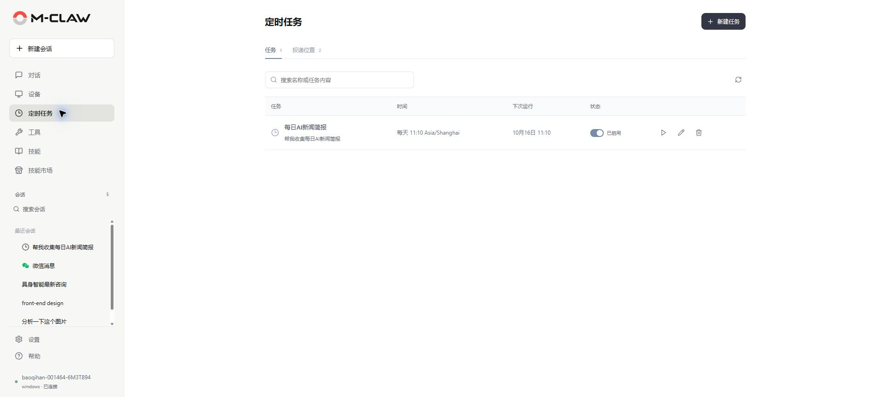
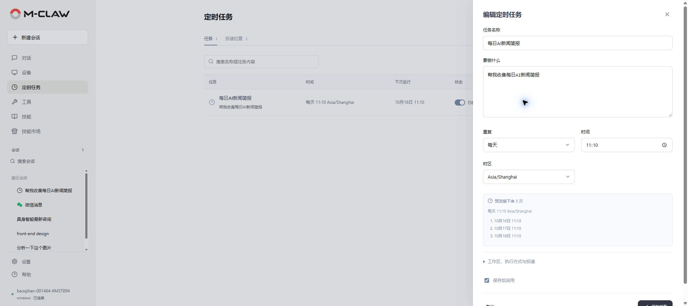

# 定时任务

[手册目录](README.md) · [上一章：设备](设备.md) · [下一章：工具](工具.md)

**本章内容**

- [创建计划](#创建计划)
- [设置执行方式](#设置执行方式)
- [绑定投递位置](#绑定投递位置)
- [试跑与维护](#试跑与维护)

**入口：侧栏 → 定时任务。** 创建单次或周期计划，查看运行记录，并选择结果的保存或投递位置。

*图 7：查看计划时间、启用状态和下次运行时间。*

## 创建计划

1. 点击“新建任务”，填写“任务名称”和“要做什么”。
2. 选择重复规则、执行时间和时区。
3. 点击“预览接下来 3 次”，核对触发时间。
4. 按需展开“工作区、执行方式与投递”，选择模型、工作区和结果位置。
5. 确认“保存后启用”的状态，点击“保存任务”。

任务内容应写明资料来源、处理目标和输出要求。例如“每次收集过去一天的项目更新，按项目汇总进展并保留来源链接”。

*图 8：编辑计划并预览接下来的执行时间。*

| 重复规则 | 设置内容 |
| --- | --- |
| 仅一次 | 完整日期和时间 |
| 每天 | 每天的执行时间 |
| 每周 | 星期和时间 |
| 每月 | 日期和时间，结合预览确认实际触发日 |
| 固定间隔 | 间隔值，例如 `30m`、`2h` |
| 自定义 Cron | 五段式表达式，例如工作日 09:00 为 `0 9 * * 1-5` |

时区决定计划时间的含义，跨地区使用时应明确选择。新计划默认时区可在“设置 → 定时任务”修改。

## 设置执行方式

“会话方式”可选“沿用此计划的会话”或“每次新建会话”。需要持续积累上下文时沿用会话；每次独立处理时新建会话。

“上一次还没完成时”可选跳过本次、排队等待、同时执行或停止上次后执行本次。其中“同时执行”要求每次新建会话。通过“最长运行时间”和“最多执行轮数”控制单次执行上限。

## 绑定投递位置

1. 先在[消息渠道](设置.md#消息渠道)完成微信或钉钉配置并连接。
2. 打开“定时任务 → 投递位置”，点击“绑定投递位置”。
3. 选择渠道并生成绑定命令，在目标微信会话或钉钉会话中发送；钉钉群按需 @ 机器人。
4. 返回页面确认绑定完成，使用“发送测试消息”核对目标。
5. 编辑计划，将该目标设为投递位置。

内置本机目标始终保留。修改、停用或删除其他投递位置前，先检查使用它的计划并调整投递设置。

## 试跑与维护

保存后使用列表中的运行按钮试跑一次。点击计划查看运行记录，核对回复、错误与投递结果；点击“查看会话”回看详细过程，必要时选择“取消本次运行”。

任务执行与消息投递分别记录状态。已生成结果但没有收到消息时，检查投递记录、目标绑定及渠道连接。

列表开关可暂停或启用计划，编辑按钮修改内容，删除按钮移除计划定义。暂停计划后，已开始的运行需要单独检查或取消；已生成的文件仍保留。

定时任务依赖后台持续运行。设备关机、休眠或后台停止期间无法保证按时执行，恢复后应核对下次运行时间和最近记录。

---

[手册目录](README.md) · [上一章：设备](设备.md) · [下一章：工具](工具.md)
