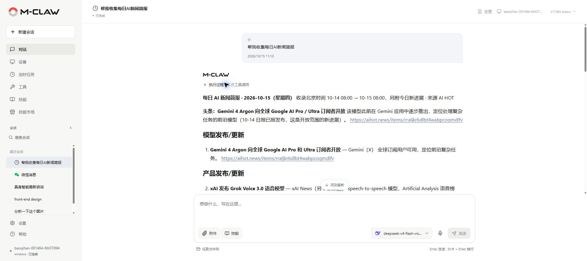
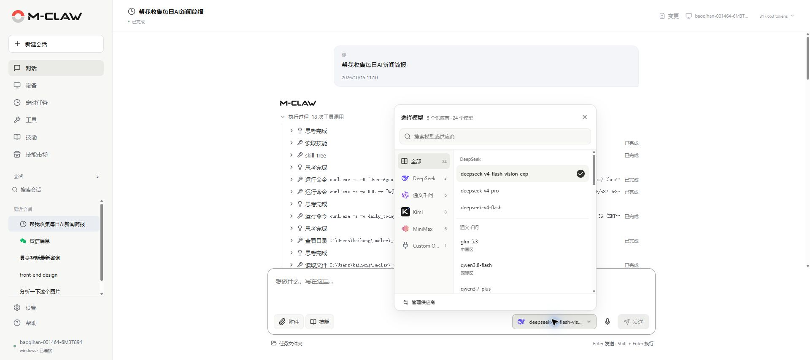
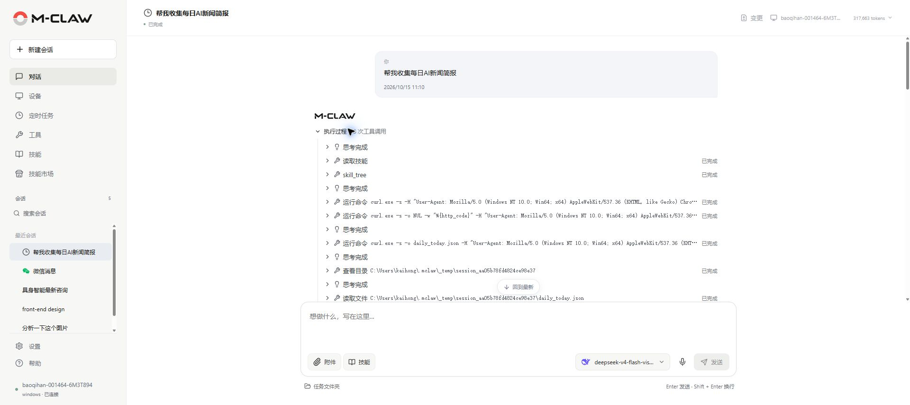

# 对话

[手册目录](README.md) · [上一章：开始使用](开始使用.md) · [下一章：设备](设备.md)

**本章内容**

- [提交任务](#提交任务)
- [选择模型与资料](#选择模型与资料)
- [查看过程与管理任务](#查看过程与管理任务)
- [处理文件、命令与后台进程](#处理文件命令与后台进程)
- [查看与恢复文件变更](#查看与恢复文件变更)
- [委派独立子任务](#委派独立子任务)
- [管理历史会话](#管理历史会话)
- [斜杠快捷操作](#斜杠快捷操作)

**入口：侧栏 → 对话。** 在一个会话中持续处理同一目标；不同项目或主题可分别创建会话。

## 提交任务

1. 点击“新建会话”。
2. 点击输入框下方的“选择工作区”，选择任务所需目录。
3. 在输入区选择已配置的模型，按需添加附件和技能。
4. 输入目标、资料来源、输出格式及完成条件，按 Enter 或点击“发送”。Shift+Enter 换行。
5. 出现工作区或凭据授权请求时，核对路径和用途，按提示处理后继续。

*图 3：阅读任务结果，并在同一会话中继续提问。*

任务使用 Python 后台所在设备的路径。选择工作区后，文件和命令操作以该目录作为任务起点；具体访问仍受系统权限和路径保护策略约束。

## 选择模型与资料

点击输入区的模型名称，按供应商浏览或搜索模型，再选择所需条目。同一供应商的不同区域分别列出。会话模型与新会话默认模型分别管理，添加模型见[供应商与模型](设置.md#供应商与模型)。

*图 4：搜索并切换当前会话使用的模型。*

| 输入内容 | 使用方法 |
| --- | --- |
| 附件 | 点击“附件”上传文件，或引用后台设备上已有的文件；发送前可移除 |
| 技能 | 点击“技能”选择已启用技能，再描述本次任务的具体要求 |
| 设备 | 在支持协作的开鸿环境选择已配对且就绪的设备，详见[设备](设备.md) |
| 语音 | 点击麦克风录音，转写内容进入草稿，检查后发送；先完成[语音输入](设置.md#语音输入)设置 |

每条消息最多添加 20 个附件，其中图片最多 8 张；上传的单个附件不超过 20 MiB。图片识别还需满足[图片理解](工具.md#图片理解)的模型与格式条件。

## 查看过程与管理任务

点击回复中的“执行过程”展开任务步骤，再展开工具条目查看参数、输出和错误。模型提供思考内容时，页面会显示对应记录。

*图 5：展开工具调用，查看任务处理步骤与结果。*

| 需要进行的操作 | 方法 |
| --- | --- |
| 当前任务结束后再执行下一项 | 执行中输入新消息，点击“排队发送” |
| 补充当前任务的要求 | 输入补充内容，点击“补充当前任务” |
| 修改尚未执行的消息 | 点击输入区上方的排队消息，修改内容、调整顺序或移除，最后点击“保存队列” |
| 暂停当前工作 | 点击输入框旁的方形停止按钮，等待工具收尾；队列同时暂停 |
| 接续暂停的任务 | 点击“继续处理”；也可先输入补充说明，再按按钮提示继续 |

切换到其他页面后，任务仍在后台执行。主会话成功完成时可通过完成提示的“查看结果”返回；尚未查看的结果在侧栏保留未读提示。

网页断线时，已提交的任务由仍在运行的后台继续处理。重新连接后先查看现有状态；后台也已停止时，重新运行 `mclaw`，打开会话并按恢复提示继续。

## 处理文件、命令与后台进程

直接在对话中说明目录、文件名、操作范围和输出位置。M-Claw 可以读写和搜索文件，运行构建、测试与诊断命令。例如“查找工作区中包含 TODO 的 Python 文件，按文件汇总待办事项”。

长时间运行的命令可以转入后台进程，之后继续查询日志、等待结果或停止进程。命令超时和单次文件读取上限可在“设置 → 任务执行”调整。

对于重要资料，先保留独立备份。涉及覆盖、删除或跨目录操作时，在任务中明确范围，并查看执行结果中的实际文件路径。

## 查看与恢复文件变更

支持文件恢复的运行环境会在相应文件操作前保存检查点。打开会话顶部的“变更”，可以查看修改记录和差异。

1. 等待任务完成，或先停止任务并等待收尾。
2. 点击“查看差异”，核对受影响的文件及会话记录。
3. 选择“撤销”或“撤销最近变更”；按页面提示确认恢复范围。
4. 需要重新应用已撤销的修改时，选择对应记录的“恢复”。
5. 出现“上次恢复操作未完成”时，先查看恢复方案，恢复到操作前状态后再继续。

恢复时会检查文件是否又被修改，必要时保留冲突副本或拒绝覆盖。撤销创建文件的操作可能删除该文件；预览同时说明对会话上下文的影响。

检查点依赖当前运行环境、Git 和“保存文件恢复记录”设置，并受数量、容量和保留时间限制。它覆盖可记录的文件变更；已发送的消息、远端操作和外部服务状态需分别处理。

## 委派独立子任务

复杂任务可拆分给子代理并行处理，再由主任务汇总。例如“分别检查项目的安装说明、命令入口和测试目录，最后汇总为一份使用说明”。

一次委派最多支持 5 个独立子任务。每个子任务有自己的上下文、超时和执行轮数，默认使用受限工具集。展开子任务详情可查看进度和结果；关闭详情不会停止任务。停止主任务时，取消信号会传递给正在执行的子任务。

## 管理历史会话

在侧栏搜索并打开会话，使用会话菜单中的“重命名”“导出 JSON”或“删除会话”。微信、钉钉和定时任务来源带有相应标识。

删除会话会移除其记录、草稿和排队任务，工作区文件保留。运行中的会话需先完成收尾。JSON 导出用于留存会话文字与记录，完整恢复仍需备份应用数据及关联文件。

同一会话同时由一个网页或终端入口控制。遇到占用提示时，在原入口继续操作，或结束其控制后再从当前入口接续。可直接请求 M-Claw 检索过去的讨论，例如“找到上次关于部署路径的结论”。

## 斜杠快捷操作

在对话输入框中输入 `/`，打开“操作与技能”列表。继续输入名称或关键词可筛选，使用上下方向键选择，按 Enter 或 Tab 确认，也可以直接点击条目；按 Esc 关闭列表。

| 快捷操作 | 作用 |
| --- | --- |
| `/clear` | 新建会话，已有会话保留在历史中 |
| `/history` | 打开并聚焦侧栏的会话搜索框 |
| `/model` | 打开模型列表，搜索并选择当前会话的模型 |

列表中还可按名称搜索并选择已启用的技能，选中后再输入任务描述并发送。选择模型后，输入区会显示新的会话模型。

---

[手册目录](README.md) · [上一章：开始使用](开始使用.md) · [下一章：设备](设备.md)
