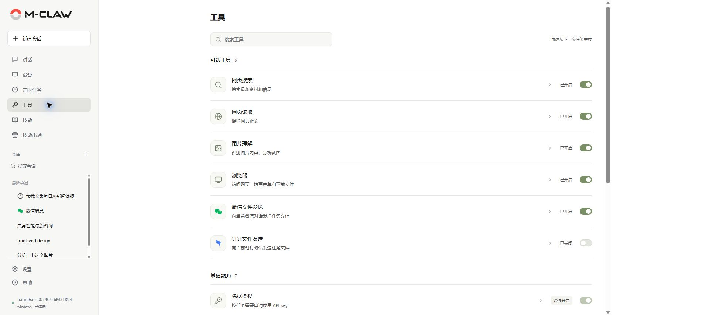
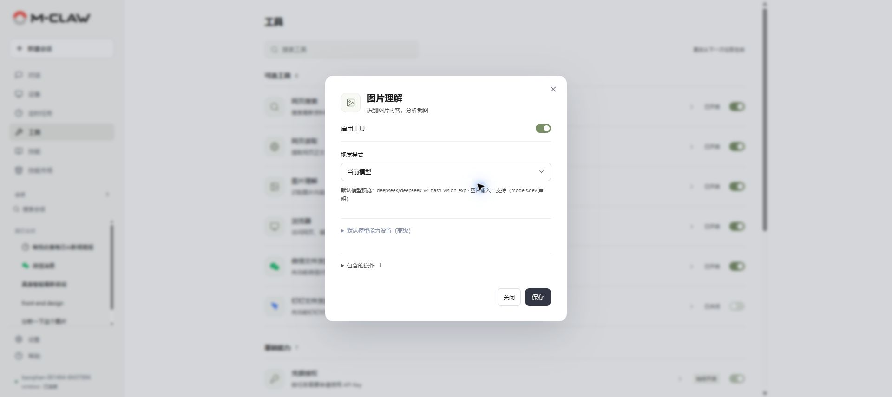
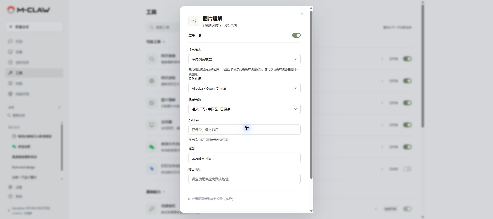

# 工具

[手册目录](README.md) · [上一章：定时任务](定时任务.md) · [下一章：技能](技能.md)

**本章内容**

- [配置与使用](#配置与使用)
- [网页搜索、读取与浏览器](#网页搜索读取与浏览器)
- [图片理解](#图片理解)
- [凭据与文件权限](#凭据与文件权限)

**入口：侧栏 → 工具。** 查看 M-Claw 可调用的能力，启停可选工具，并配置服务来源与凭据。

*图 9：查找工具、查看说明并调整启用状态。*

## 配置与使用

按名称或用途搜索工具，点击条目查看说明和包含的操作。需要服务来源或 API Key 时，完成配置后保存。工具页的更改从下一次任务生效。

基础能力由系统管理。可选工具显示“已开启”后，还需满足依赖、凭据、网络和平台条件；异常时打开[运行检查](设置.md#运行检查)。

文件、终端、历史检索和子代理的日常用法见[对话](对话.md)。本页主要配置网页、图片和渠道文件发送等可选能力。

## 网页搜索、读取与浏览器

网页搜索可使用 Tavily 或 Qwen；网页读取可选择本地 Trafilatura 或 Tavily、Firecrawl 等服务。进入相应工具选择后端，按需填写凭据后保存。

浏览器工具需要 Playwright 和匹配的 Chromium。打开 M-Claw 网页所用的系统浏览器与该自动化环境分别配置。安装方法见[项目中文说明](../../README.zh-CN.md#按需安装浏览器自动化与桌面能力)。

任务中提供目标网址和操作要求，例如“打开这个页面，提取产品规格并保存为表格”。

## 图片理解

打开“图片理解”，启用工具并选择视觉模式：

| 模式 | 处理方式 |
| --- | --- |
| 自动 | 根据当前会话模型的图片输入能力，选择当前模型或已配置的专用视觉模型 |
| 当前模型 | 图片直接交给当前会话模型，沿用其接口和凭据 |
| 专用视觉模型 | 由独立配置的模型分析图片，再将分析文字交给当前会话模型 |

*图 10：使用当前会话模型理解图片。*

当前模型模式要求所选模型能够处理图片。界面中的默认模型预览用于配置参考，实际任务以会话选中的模型为准。

*图 11：设置专用视觉模型的服务来源、凭据和模型名称。*

选择专用视觉模型后，填写或复用对应凭据，选择支持图片的模型并保存。使用默认接口时可按提示留空；自定义服务需填写实际地址。

自动模式在当前模型能力未知时优先使用已就绪的专用模型，否则尝试当前模型。切换模式会保留已有专用模型配置和凭据。

回到对话添加图片，说明需要识别的区域或问题。单个源文件不超过 20 MiB、6400 万像素；供应商可能有更严格的输入限制。关闭图片理解会停止新图片和自动截图的看图处理。

## 凭据与文件权限

工具按功能范围申请使用凭据。出现授权请求时，核对申请用途，再通过专用表单填写或复用；已保存的密钥不会在设置中回显。

文件与终端工具使用当前系统用户权限，并保护凭据、应用数据和系统关键路径。遇到路径拒绝时，核对工作区和操作目标，按提示调整任务范围。

---

[手册目录](README.md) · [上一章：定时任务](定时任务.md) · [下一章：技能](技能.md)
