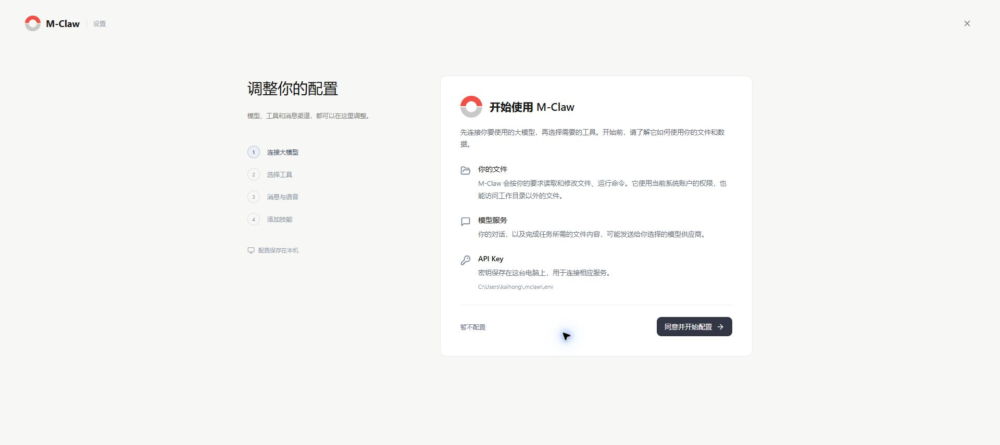

# 开始使用

[手册目录](README.md) · [下一章：对话](对话.md)

**本章内容**

- [安装与运行环境](#安装与运行环境)
- [启动与停止](#启动与停止)
- [完成首次设置](#完成首次设置)

## 安装与运行环境

M-Claw 支持 Windows、Kaihong OS / M-Robots OS。任务在运行设备上执行，浏览器用于提交操作和查看结果。

| 环境 | 要求 |
| --- | --- |
| 运行设备 | Python 3.11 或更高版本 |
| 构建电脑 | Node.js 22.12 或更高版本、npm 10 或更高版本 |
| 浏览器 | 支持 JavaScript；语音输入还需麦克风与录音支持 |
| Git | 获取源码；文件检查点也依赖运行设备上的 Git |
| HDC | 从电脑向开鸿设备传输源码与构建资源 |

完整安装步骤见[项目中文说明](../../README.zh-CN.md#安装与启动)。已有安装应继续使用原 Python 环境。

Kaihong OS/M-Robot OS端采用 “电脑构建前端 → 传入源码与静态资源 → 设备安装” 的流程。
在电脑构建后，将同版本源码与完整的 `mclaw/web/static/` 一起传入设备；设备运行时使用 Python 提供网页，无需安装 Node.js/npm。

进入设备上包含 `pyproject.toml` 的源码根目录，在设备 shell 中执行：

```sh
run python3 -m pip install -e .
run mclaw setup
run mclaw
```

`run` 由设备系统环境提供。editable 安装直接使用该源码目录，安装后应保留目录及其路径。

## 启动与停止

在安装 M-Claw 的终端环境中运行以下命令；开鸿设备在命令前加 `run`。

| 命令 | 作用 |
| --- | --- |
| `mclaw` | 启动或连接本机后台，打开网页 |
| `mclaw status` | 查看实际服务地址和进程状态 |
| `mclaw stop` | 保存进展，等待任务收尾并停止后台 |
| `mclaw doctor` | 检查运行环境、依赖和功能状态 |
| `mclaw cli` | 打开终端交互界面 |

运行 `mclaw` 后，浏览器会自动打开。若未打开，使用启动输出中的完整本机链接。后台默认从 `127.0.0.1:18031` 开始尝试端口，实际地址以 `mclaw status` 为准。

关闭网页或启动它的终端窗口后，后台继续运行。需要退出时运行 `mclaw stop`，或打开“设置 → 常规 → 退出 M-Claw”。停止后台会同时停止受管的定时任务和消息渠道。

## 完成首次设置

首次启动进入设置向导；已有配置时进入对话。之后可从“设置 → 常规 → 设置向导”重新打开。



*图 1：在设置向导中连接模型、选择工具并配置消息与语音。*

1. 阅读文件权限、模型服务和凭据保存说明，点击“同意并开始配置”。
2. **连接大模型**：选择供应商、API 区域与接口，填写模型和凭据。接口、区域及密钥应相互匹配。
3. **选择工具**：按需配置网页搜索、网页读取、图片理解和浏览器等能力。
4. **消息与语音**：按需配置微信、钉钉和语音输入；可选项目按页面提供的选项跳过。
5. **添加技能**：选择需要的技能，等待安装、检查和保存完成。

已有凭据可按“留空沿用”等提示复用。探测失败时，先核对模型名、服务地址、凭据和网络，再按提示重试。关闭向导会结束当前配置流程，已经完成保存的配置会保留。

M-Claw 使用当前系统用户的权限读写文件和运行命令。任务所需的对话与文件内容可能发送给所选模型服务。API Key 保存在本机，后续设置页面只显示保存状态。


*图 2：Kaihong BotBook 上的 M-Claw 主界面。*

侧栏提供对话、设备、定时任务、工具、技能和技能市场入口，底部是设置与帮助。已有任务保留在会话列表中，可搜索后继续处理。

**工作区**是任务读写文件的目录；**应用数据目录**保存配置、凭据、技能和历史。未选择工作区时，M-Claw 在任务文件目录下为会话分配独立目录。两类目录的备份方法见[更新与数据恢复](更新与数据恢复.md)。

---

[手册目录](README.md) · [下一章：对话](对话.md)
