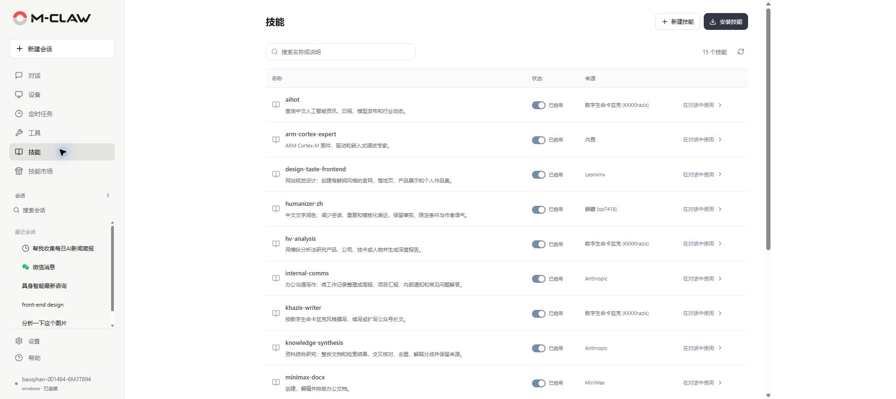
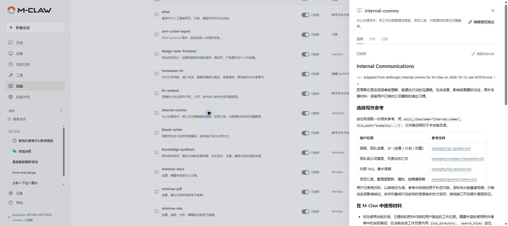

# 技能

[手册目录](README.md) · [上一章：工具](工具.md) · [下一章：技能市场](技能市场.md)

**本章内容**

- [查看与使用](#查看与使用)
- [安装、新建与编辑](#安装新建与编辑)
- [停用、删除与经验保存](#停用删除与经验保存)

**入口：侧栏 → 技能。** 技能将说明、脚本和资源组织为可复用流程，用于完成写作、文件处理、研究或开发等任务。

*图 12：搜索已安装技能，并选择在对话中使用。*

## 查看与使用

1. 按名称或说明搜索技能，点击条目打开详情。
2. 阅读适用场景、依赖和操作要求，确认技能已启用。
3. 点击“在对话中使用”，或在对话输入区选择该技能。
4. 添加本次任务的资料、目标和输出要求后发送。

列表显示本机已安装的技能，使用时还需满足对应工具、依赖与授权要求。

*图 13：阅读技能说明，并查看资源文件和使用记录。*

## 安装、新建与编辑

从[技能市场](技能市场.md)浏览安装，或点击“安装技能”，填写仓库、下载地址或本机目录等受支持来源。点击“检查并准备安装”，阅读检查结果后按提示确认，完成后核对启用状态。

点击“新建技能”填写名称和内容。已有技能可通过“编辑简短描述”调整列表说明，通过“编辑技能内容”修改完整步骤与输出约定。

“文件”用于查看脚本与资源，并编辑页面允许修改的文件；“记录”显示变更与使用记录，“来源与版本”用于核对来源、作者和版本。

保存时出现内容冲突，应重新读取当前内容，合并修改后再保存。自行改写第三方技能时，保留适用的许可和署名。

## 停用、删除与经验保存

暂时不用的技能可在列表中停用。删除会移除本机技能文件，先保存需要保留的自行修改内容。

任务完成后，M-Claw 可根据配置整理长期记忆或技能经验。技能成功保存时，原会话会显示可展开的“技能已保存”通知，可查看内容并进入技能详情。自动整理间隔在“设置 → 记忆与偏好”中调整。

---

[手册目录](README.md) · [上一章：工具](工具.md) · [下一章：技能市场](技能市场.md)
