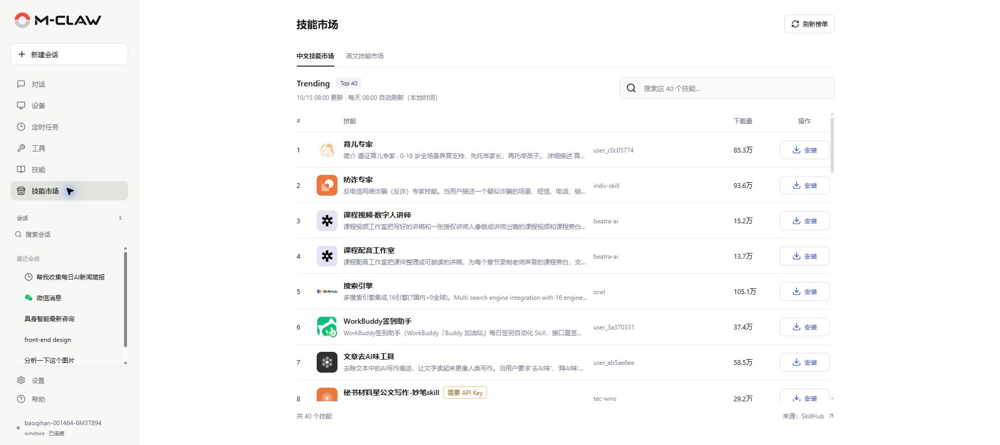
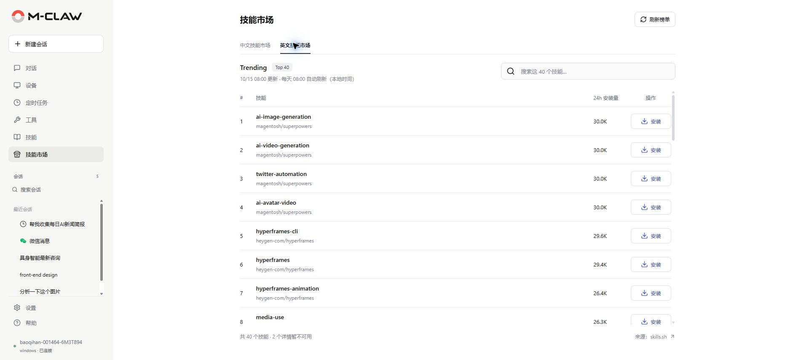
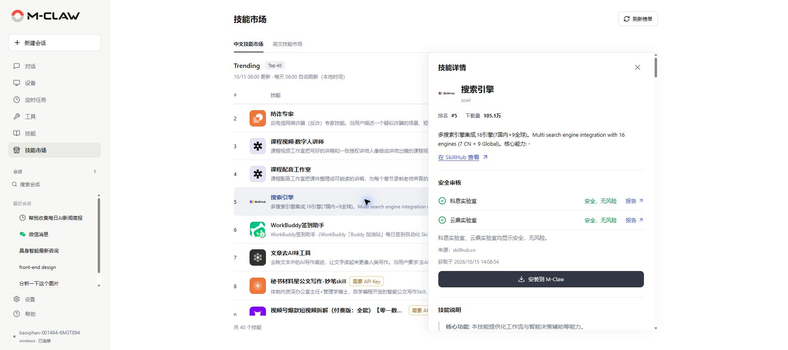

# 技能市场

[手册目录](README.md) · [上一章：技能](技能.md) · [下一章：设置](设置.md)

**本章内容**

- [浏览与搜索](#浏览与搜索)
- [阅读详情与安装](#阅读详情与安装)

**入口：侧栏 → 技能市场。** 浏览热门技能，阅读用途、来源和审核报告，安装后回到技能页使用。

## 浏览与搜索

*图 14：浏览中文技能及其下载量和依赖提示。*

“中文技能市场”来自 SkillHub，展示中文说明和下载量；“英文技能市场”来自 skills.sh，展示技能来源和 24 小时安装量。

*图 15：查看英文技能的来源和 24 小时安装量。*

两个市场分别展示 Trending 前 40 个技能，搜索范围为当前榜单。需要查找其他技能时，可在对话中描述用途，让 M-Claw 搜索候选。

榜单按本地时间每天 08:00 自动刷新，也可点击“刷新榜单”。更新时间显示在列表上方，浏览和刷新榜单不调用模型。

## 阅读详情与安装

点击技能名称，在详情中阅读说明、来源、依赖提示和审核信息。

*图 16：查看技能说明与审核报告，再安装到 M-Claw。*

英文市场展示综合安全评估、代码安全检查和指令风险检查，分别对应 Gen、Socket、Snyk；中文市场展示科恩实验室和云鼎实验室的来源报告。点击报告可查看具体结论，“暂无报告”表示目前没有可用结论。

确认用途、API Key 或付费要求后，点击“安装”或“安装到 M-Claw”。等待完成，再到技能页确认安装和启用状态。同一来源已安装时会复用已有结果；出现同名冲突时，先核对来源与本机内容。

详情和审核信息可能分别完成加载，页面显示获取时间与准备状态。来源限流或网络异常时，先使用已有缓存，待连接恢复后刷新；手动刷新也遵守来源冷却时间。

---

[手册目录](README.md) · [上一章：技能](技能.md) · [下一章：设置](设置.md)
