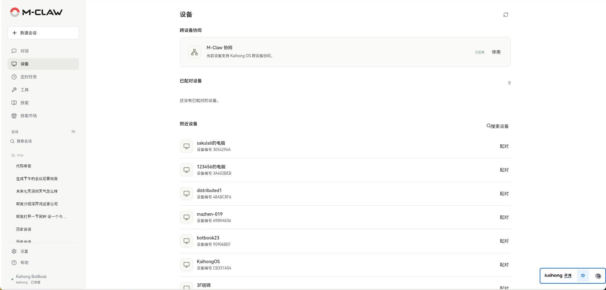

# 设备

[手册目录](README.md) · [上一章：对话](对话.md) · [下一章：定时任务](定时任务.md)

**本章内容**

- [启用与配对](#启用与配对)
- [分配任务与共享文件](#分配任务与共享文件)

**入口：侧栏 → 设备。** 查看本机信息，管理可信设备，并检查远端 M-Claw 是否能够接收任务。



*图 6：Kaihong BotBook 的跨设备协同。*

## 启用与配对

可信设备协作需要受支持的 ARM64 OpenHarmony 运行环境、DSoftBus 系统组件和相应权限，由 Kaihong OS / M-Robots OS 提供。
两端均需完成安装、启用协同并运行 M-Claw。

1. 在两端打开“设备”，启用“M-Claw 协同”，等待运行环境检查完成。
2. 点击“搜索设备”，确认目标设备名称。
3. 点击目标设备旁的“配对”，按两端系统提示完成信任确认与 PIN 验证。
4. 返回已配对设备列表，等待目标在线且 M-Claw 就绪。

“已配对”表示建立系统信任。对端休眠、断网或 M-Claw 未启动时，配对关系仍可能保留，但任务暂时无法执行。

## 分配任务与共享文件

回到对话，在设备入口选择目标，并说明任务与所需资料。未指定设备时，M-Claw 可按任务需要选择可协作设备。

```text
# 示例
让对端设备检查系统信息，返回可用开发工具及版本。
将 /data/local/tmp/report.txt 交给所选设备检查，返回修订后的文件。
让所选设备分析 /data/local/tmp/project 中的登录流程，按需读取相关文件。
```

文件会作为副本传入远端任务的独立工作区。共享目录时，远端只可在明确的范围内浏览、搜索和获取文件，再修改获取到的工作副本。两端路径分别属于各自设备。

单个输入文件和单个返回文件上限为 16 MiB；每个任务输入文件累计上限为 64 MiB，最多声明 31 个初始输入路径。图片分析还需要远端配置图片理解能力。

远端进展、补充资料请求和返回文件显示在执行过程中。收到补充请求后，可在当前会话提供文字或文件，继续原远端任务。返回文件保存为本机结果文件，检查后再决定是否应用到原目录。

停用设备协同会断开连接并保留配对关系；解除配对会移除对应信任，后续协作需重新配对。停止 M-Claw 后，本机暂时无法接收远端任务。

---

[手册目录](README.md) · [上一章：对话](对话.md) · [下一章：定时任务](定时任务.md)
