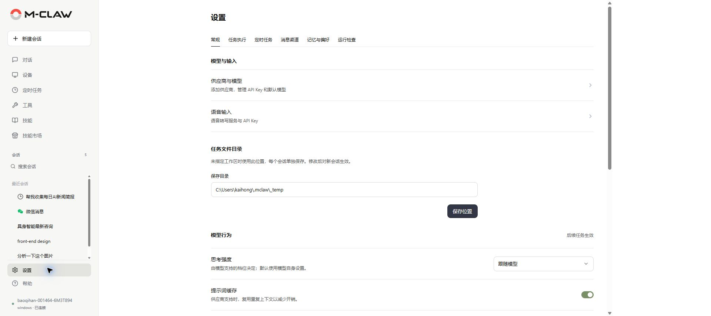
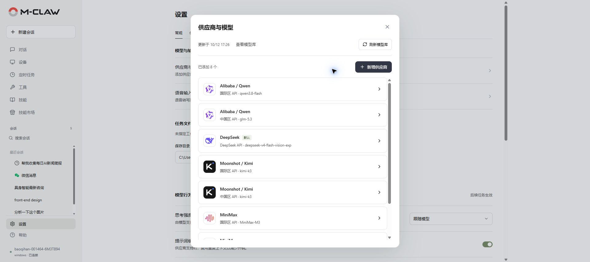
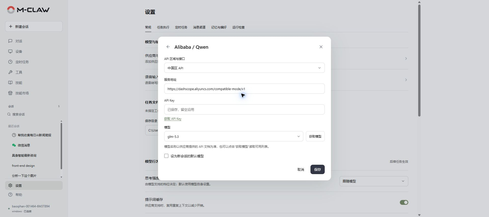
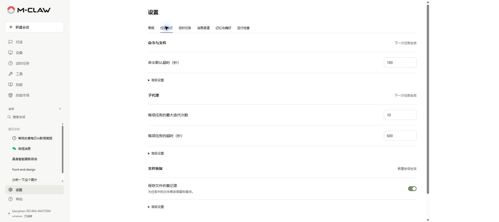
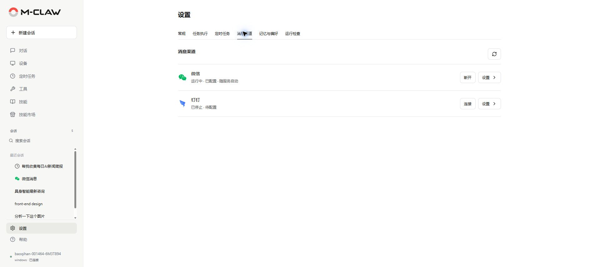
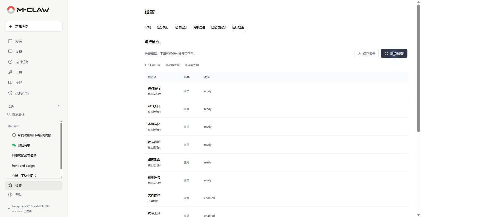

# 设置

[手册目录](README.md) · [上一章：技能市场](技能市场.md) · [下一章：更新与数据恢复](更新与数据恢复.md)

**本章内容**

- [供应商与模型](#供应商与模型)
- [任务文件与模型行为](#任务文件与模型行为)
- [语音输入](#语音输入)
- [任务执行设置](#任务执行设置)
- [定时任务设置](#定时任务设置)
- [消息渠道](#消息渠道)
- [记忆与偏好](#记忆与偏好)
- [运行检查](#运行检查)

**入口：侧栏底部 → 设置。** 设置由网页、终端和消息渠道共用，各组注明“后续任务生效”“新建会话生效”或需要重启等生效时机。

*图 17：配置模型、输入方式和任务文件保存位置。*

## 供应商与模型

打开“设置 → 常规 → 供应商与模型”，查看已有接入，或点击“新增供应商”。

*图 18：管理供应商接入，并刷新模型库。*

1. 选择供应商品牌，再选择“API 区域与接口”。
2. 核对服务地址，填写 API Key；已有凭据按提示留空沿用。
3. 选择或填写模型名，必要时点击“获取模型”读取接口返回的列表。
4. 按需勾选“设为新会话的默认模型”，点击“保存”。

*图 19：保存供应商接口、凭据及默认模型。*

不同区域或接口的凭据和模型可能不同。“刷新模型库”更新模型目录缓存，“获取模型”查询所选接入的模型列表，实际调用权限由供应商账户决定。自定义服务需同时核对协议、Base URL 与模型标识。

## 任务文件与模型行为

“任务文件目录”用于未指定工作区的新会话，每个会话单独保存文件。点击“保存位置”后对新会话生效，已有工作区文件保留在原位置。

“模型行为”设置思考强度和提示词缓存，是否支持由模型与供应商决定。高级设置中的“首段回复等待时间”和“回复中断等待时间”均以秒为单位，范围为 1–600；修改对后续任务生效。

“上下文压缩”在长对话中整理前文，为后续任务留出空间。开关、触发比例和摘要模型等配置对新建会话生效。

## 语音输入

打开“常规 → 语音输入”，选择 Qwen 服务区域，填写或复用对应 API Key，启用后保存。

回到对话，允许浏览器使用麦克风，点击语音按钮开始录音，再次点击结束并转写。单次录音最长 120 秒，转写文字先加入草稿，检查后发送。录音会发送至配置的 Qwen 服务处理。

微信、钉钉的原生语音消息识别可在设置向导中配置。普通音频文件附件不会自动按语音消息处理；单条原生语音默认不超过 120 秒、7 MiB。

## 任务执行设置

*图 20：调整命令限制、子任务参数与文件恢复记录。*

“命令与文件”设置命令默认超时、超时上限和读取字符上限；“子代理”设置每项任务的执行轮数、超时和所用模型。两组对下一次任务生效。

“文件恢复”设置是否保存恢复记录，以及数量、容量和保留时间，对新会话生效。运行环境仍需支持检查点并具备 Git，具体操作见[查看与恢复文件变更](对话.md#查看与恢复文件变更)。

## 定时任务设置

“新建计划的默认值”控制默认时区、超时和最大执行轮数，对新计划生效。已有计划在侧栏的“定时任务”中编辑。

“调度服务”控制自动执行、同时执行数、检查间隔和连续失败后的暂停条件等，保存后需重启 M-Claw 服务。重启步骤见[启动与停止](开始使用.md#启动与停止)。

## 消息渠道

*图 21：配置消息渠道，并连接或断开网关。*

1. 打开目标渠道的“设置”。
2. 微信按扫码登录提示认证；钉钉填写应用凭据并配置访问范围。
3. 保存后返回列表，点击“连接”，确认状态为运行中。
4. 从对应聊天发送试用消息，确认任务与回复正常。
5. 需要停用时点击“断开”，是否随服务启动以配置状态为准。

微信面向私聊，钉钉支持私聊和群聊；钉钉默认群策略通常需要 @ 机器人。按实际使用范围配置允许的用户和会话。

回复返回原聊天，支持的文件发送工具也面向当前渠道会话。定时投递另需完成[投递位置绑定](定时任务.md#绑定投递位置)。

## 记忆与偏好

“长期记忆”保存项目约定、环境信息等稳定事实；“个人偏好”保存表达习惯与输出要求。切换相应标签，编辑内容后点击“保存修改”。

也可在对话中要求更新，例如“记住这个项目使用 Python 3.11”“把报告偏好改为先结论后证据”或“删除测试服务器地址的记忆”。出现保存冲突时，读取最新内容，合并后再提交。

会话历史保存任务记录，长期记忆与个人偏好供后续会话参考，技能经验保存可复用的操作流程。自动整理按配置轮数进行；记忆和技能整理间隔设为 0 时关闭相应的定期检查，仍可在对话中主动要求保存。

## 运行检查

*图 22：检查运行环境，查看结果说明并保存报告。*

点击“开始检查”，查看“正常”“需注意”“需处理”及各项说明。可选功能未配置也可能显示正常，应结合说明判断是否可用。修复后再次检查，反馈问题时可先“保存报告”。

---

[手册目录](README.md) · [上一章：技能市场](技能市场.md) · [下一章：更新与数据恢复](更新与数据恢复.md)
